  

  
  
  
  
  
  

# 🚀 Awesome Cloud Storage Snapshot Management

> 🌐 **Curated List of Enterprise SaaS Platforms, Hyperscaler Snapshot APIs & Open-Source Snapshot Management Solutions**  
> *Focused on Point-in-Time Copies, Storage Snapshot Orchestration, Immutable Air-Gapped Vaults, and Cyber-Resilient Disaster Recovery.*  
> **Last updated: March 2026**

---

## 📌 Executive Summary & Quick Navigation

Managing snapshots across modern hybrid-cloud architectures requires balancing **Recovery Point Objectives (RPO)**, **Recovery Time Objectives (RTO)**, and storage costs. This directory serves as a comprehensive, SEO-optimized guide to **point-in-time snapshot engines**, **Container Storage Interface (CSI) snapshot controllers**, **block storage lifecycles**, and **cyber-resilient backup orchestration** across AWS, Azure, Google Cloud Platform (GCP), on-premises SAN/NAS, and Linux filesystems.

### 📑 Table of Contents
- [📊 Sector Overview & Market Dynamics](#-sector-overview--market-dynamics)
- [🏢 SaaS & Hosted Enterprise Platforms](#-saas--hosted-enterprise-platforms)
- [💻 Open-Source Snapshot Projects](#-open-source-snapshot-projects)
- [🏗️ Recommended Architecture & Frameworks](#-recommended-architecture--frameworks)
- [🤝 How to Contribute](#-how-to-contribute)
- [💖 Support & Community](#-support--community)
- [📈 Star History](#-star-history)
- [⚠️ Disclaimer](#-disclaimer)

---

## 📊 Sector Overview & Market Dynamics

The global **cloud storage, data protection, and snapshot recovery** market is valued at approximately **$156B to $190B in 2025–2026** (with the dedicated enterprise backup and snapshot recovery segment alone accounting for **$11B to $16B**) and is projected to exceed **$260B to $500B by 2030** at a rapid CAGR of over 20%.

The market exhibits a distinct dual dynamic:
* **Infrastructure Layer (Highly Concentrated / Oligopolistic):** Hyperscalers (**AWS, Microsoft Azure, Google Cloud**) along with foundational storage hardware giants dominate raw block storage, persistent disk volume management, and underlying snapshot snapshot pointer persistence.
* **Orchestration & Data Protection Layer (Moderately to Highly Fragmented):** While established players like Veeam, Rubrik, and Dell command substantial enterprise share, the software orchestration, multi-cloud lifecycle management, CSI volume snapshot tooling, and ransomware immutability layer remains fragmented among specialized SaaS vendors, Kubernetes-native tools, and vibrant open-source snapshot solutions.

---

## 🏢 SaaS & Hosted Enterprise Platforms

The table below catalogs leading enterprise SaaS platforms and managed cloud snapshot engines. Entries are **sorted descending by company scale** (market capitalization / valuation / annual revenue).

| 🏢 Product | 📈 Scale (Revenue / Valuation) | 📝 Description | 💳 Pricing (Starting Tier) | 🎁 Free Tier / Trial Limits |
|---|---|---|---|---|
| **[Azure Backup Snapshots](https://azure.microsoft.com/en-us/products/backup/)** | **~$3.1 Trillion Market Cap** (Microsoft; Cloud ~$130B+/yr) | Instant disk snapshots integrated with Azure Backup for VMs and SAP HANA. Enhanced policy stores snapshots in Recovery Services Vault with immutability, soft delete, and cross-region restore. | Protected instance fee starts at $5/month (instances ≤ 50 GB) + snapshot storage at $0.05/GB-month (LRS) | **Azure Free Account**: $200 free credit valid for 30 days + 55+ services free for 12 months |
| **[AWS EBS Snapshots](https://aws.amazon.com/ebs/snapshots/)** | **~$2.2 Trillion Market Cap** (Amazon; AWS ~$105B+/yr) | Incremental block-level snapshots of EBS volumes. Standard tier for regular access; Archive tier for long-term retention (90+ days). Data Lifecycle Manager (DLM) automates snapshot creation and retention at no additional fee. | Standard: $0.05/GB-month; Archive: $0.0125/GB-month | **AWS Free Tier**: 1 GB of EBS snapshot storage per month (12 months free for new accounts) |
| **[Google Cloud Persistent Disk Snapshots](https://cloud.google.com/compute/docs/disks/create-snapshots)** | **~$2.1 Trillion Market Cap** (Alphabet; GCP ~$40B+/yr) | Incremental, compressed snapshots of Persistent Disk and Hyperdisk. Standard tier for active recovery; Archive tier for 90-day minimum long-term retention. Billed on actual compressed differential bytes. | Standard: ~$0.05/GiB-month; Archive: ~$0.019/GiB-month (plus $0.019/GiB retrieval fee) | **GCP Free Tier**: 5 GB-months of persistent disk snapshot storage per month (free forever in eligible US regions) |
| **[Dell EMC Unity Snapshots](https://www.dell.com/)** | **~$90 Billion Market Cap** (~$90B+ Annual Revenue) | Unified snapshots for NAS and SAN on Dell Unity and UnityVSA virtual arrays. Supports point-in-time read-only or read-write snapshots with automated expiration and replication. | UnityVSA Professional Edition subscription starts at ~$450 to $560/year for 10 TB capacity tier | **UnityVSA Community Edition**: 100% free forever up to 4 TB usable capacity (for lab/test/dev) |
| **[HPE Nimble Storage Snapshots](https://www.hpe.com/)** | **~$26 Billion Market Cap** (~$29B+ Annual Revenue) | Redirect-on-write volume snapshots and multi-volume consistency groups integrated into HPE GreenLake for Block Storage and OpenStack Cinder. | HPE Alletra / Nimble entry hardware/GreenLake subscriptions start at ~$25,000 to $30,000 for base configurations; GreenLake Block Storage starting at custom baseline reserve commits | 90-day free evaluation subscription for HPE GreenLake cloud-managed storage and data services |
| **[NetApp Snapshot](https://www.netapp.com/)** | **~$25 Billion Market Cap** (~$6.3B+ Annual Revenue) | Foundational snapshot technology built into ONTAP. Uses WAFL pointer manipulation to create space-efficient point-in-time copies. Cloud Volumes ONTAP (CVO) extends snapshot management to AWS, Azure, and GCP. | Cloud Volumes ONTAP PAYG starts at ~$0.062/TiB-hour ($45/TiB-month); on-prem ONTAP bundled with hardware/system licenses | Freemium tier free indefinitely up to 500 GiB; 30-day free trial on cloud marketplaces |
| **[Pure Storage FlashRecover](https://www.purestorage.com/)** | **~$17 Billion Market Cap** (~$3.1B+ Annual Revenue) | Joint all-flash snapshot and rapid DR solution (Pure FlashBlade/FlashArray + Cohesity DataProtect) with immutable SafeMode snapshots and sub-minute recovery points. | Pure FlashArray entry configurations start at ~$30,000 to $40,000 (hardware + 3-year support), or Evergreen//One storage-as-a-service starting at 50 TiB reserve commit | 30-day proof-of-concept (PoC) evaluation via Pure Storage and authorized channel partners |
| **[Nutanix Prism Snapshots](https://www.nutanix.com/)** | **~$15 Billion Market Cap** (~$2.1B+ Annual Revenue) | Granular VM and volume snapshots in Prism Central featuring Secure Snapshots (WORM immutability) and Approval Policies for protection against unauthorized deletion. | Nutanix Cloud Infrastructure (NCI) Starter edition starts at ~$330/core-year (or Pay-As-You-Go on NC2 cloud clusters at ~$0.10/core-hour) | **Nutanix Community Edition (CE)**: 100% free forever on non-production hardware; 30-day free trial on Nutanix Cloud Clusters (NC2) |
| **[Rubrik Security Cloud](https://www.rubrik.com/)** | **~$9 Billion Market Cap** (~$800M+ Annual Revenue) | SLA-driven snapshot orchestration with immutable retention, automated ransomware quarantine, anomaly detection, and declarative policy management via Terraform. | Entry-level enterprise subscriptions start at ~$50,000/year (Foundation tier; median contracts ~$154,000/year for ~100 workloads/FETB) | 30-day proof-of-concept (PoC) free trial for SaaS workloads (e.g. M365/cloud data protection) |
| **[Veeam Backup & Replication](https://www.veeam.com/)** | **~$5 Billion Valuation** (~$1.5B+ Annual Revenue) | Storage snapshot orchestration and backup across major arrays and cloud volumes. Backup from Storage Snapshots minimizes VM stun and IO impact. | Veeam Data Platform Essentials starts at $95/workload-year ($7.92/workload-month, sold in 5-instance packs) | **Community Edition**: 100% free forever for up to 10 workloads (VMs, cloud instances, or physical servers) |
| **[Druva](https://www.druva.com/)** | **~$2 Billion Valuation** (~$250M+ ARR) | Fully hosted SaaS data protection with automated snapshot management across VMware, Hyper-V, Nutanix AHV, and AWS/Azure cloud workloads with air-gapped immutable backups. | AWS Marketplace / Phoenix Business tier starts at ~$450/TB annual commitment (~$37.50/TB-month after global deduplication) | 30-day full-featured free trial with cloud storage allocation |

---

## 💻 Open-Source Snapshot Projects

Self-hosted, vendor-neutral snapshot orchestration, volume backup, and point-in-time filesystem recovery tools. **Sorted descending by GitHub star count**. Each star badge links directly to that repository's stargazers page.

| 📦 Project | ⭐ Stars | 📝 Description | 🔗 Primary Use Case |
|---|---|---|---|
| **[Rclone](https://github.com/rclone/rclone)** |  | "Swiss army knife" for cloud storage sync, copy, and snapshot archival to 70+ cloud providers (S3, B2, Azure Blob, GCS, SFTP). | Multi-cloud snapshot synchronization & offsite archival |
| **[Restic](https://github.com/restic/restic)** |  | Fast, secure, deduplicated backup CLI with immutable snapshot-based versioning. Every snapshot is an independent, complete directory tree. | Deduplicated snapshot-based backup to local & object storage |
| **[Duplicati](https://github.com/duplicati/duplicati)** |  | Free backup client for securely storing encrypted, incremental, snapshot-based backups on cloud storage services and remote file servers. | Desktop & server automated snapshot backup with Web UI |
| **[Kopia](https://github.com/kopia/kopia)** |  | Cross-platform backup engine featuring client-side deduplication, end-to-end encryption, snapshot scheduling, and rich UI/CLI. | Enterprise & personal encrypted point-in-time snapshotting |
| **[BorgBackup](https://github.com/borgbackup/borg)** |  | Deduplicating archiver with authenticated encryption. Point-in-time snapshots are efficiently managed with pruning policies. | Production-grade server snapshot archive & retention |
| **[OpenZFS](https://github.com/openzfs/zfs)** |  | Advanced file system and volume manager with native copy-on-write snapshots, clones, incremental send/receive, and dataset encryption. | Foundation for local and network snapshot storage engines |
| **[Velero](https://github.com/vmware-tanzu/velero)** |  | Kubernetes disaster recovery, cluster migration, and persistent volume snapshot orchestration across AWS EBS, Azure Disk, and GCP PD. | Cloud-native Kubernetes persistent volume snapshotting |
| **[OpenEBS](https://github.com/openebs/openebs)** |  | Kubernetes-native container attached storage (CAS) engine with local/replicated engines and built-in volume snapshot capabilities. | Stateful Kubernetes workload volume snapshot management |
| **[Longhorn](https://github.com/longhorn/longhorn)** |  | Cloud-native distributed block storage for Kubernetes with scheduled snapshots, incremental backups to NFS/S3, and automated volume recovery. | Distributed block storage snapshot orchestration |
| **[Backrest](https://github.com/garethgeorge/backrest)** |  | Web UI and orchestrator for Restic repositories, providing automated snapshot scheduling, health monitoring, and diff browsing. | Visual snapshot scheduling and repository management |
| **[Bup](https://github.com/bup/bup)** |  | Git-packfile-based backup system providing rolling snapshots, deduplication, and volume recovery for large filesystem images. | Rolling disk image snapshots and git-packfile storage |
| **[Sanoid](https://github.com/jimsalterjrs/sanoid)** |  | Policy-driven snapshot management and replication tool for ZFS and Btrfs filesystems, with `syncoid` for incremental transfer. | Automated policy-based ZFS/Btrfs snapshot pruning |
| **[Democratic-CSI](https://github.com/democratic-csi/democratic-csi)** |  | CSI storage driver implementing volume provisioning and snapshot lifecycle for TrueNAS/FreeNAS, ZFS over SSH, and custom arrays. | Storage array CSI volume snapshotting in Kubernetes |
| **[Snapper](https://github.com/openSUSE/snapper)** |  | Linux snapshot manager for Btrfs, ext4/LVM, and thin-provisioned storage with pre/post timeline diffs and automatic rollback. | OS-level timeline snapshots and system rollbacks |
| **[Zrepl](https://github.com/zrepl/zrepl)** |  | One-stop, daemon-based ZFS replication and snapshot management solution with TLS encryption and automatic pruning. | Automated cross-host continuous ZFS snapshot replication |
| **[External-Snapshotter](https://github.com/kubernetes-csi/external-snapshotter)** |  | Official Kubernetes CSI Snapshot Controller, VolumeSnapshot CRD definitions, and snapshot-validation-webhook implementation. | Core Kubernetes VolumeSnapshot API specification & controller |

---

## 🏗️ Recommended Architecture & Frameworks

Building a reliable, ransomware-proof snapshot management infrastructure typically involves combining tools across architectural layers:

1. **Local Persistent Storage & Snapshot Layer**:
   * Deploy **OpenZFS**, **Btrfs (via Snapper/Sanoid)**, or cloud persistent disks (AWS gp3, Azure Managed Disks, GCP PD) for sub-second, redirect-on-write crash-consistent snapshots.
2. **Kubernetes CSI Volume Management**:
   * Implement the official **Kubernetes External-Snapshotter** controller alongside **Velero**, **Longhorn**, or **Democratic-CSI** to manage application-consistent `VolumeSnapshot` custom resources across multi-cluster workloads.
3. **Offsite Immutable Object Storage Tier**:
   * Periodically export and sync differential snapshots using **Restic**, **Kopia**, or **Rclone** to immutable S3 Object Lock or Azure Blob Immutability vaults to safeguard against credential compromise.

---

## 🤝 How to Contribute

We welcome additions, corrections, and improvements from the cloud storage and data engineering community!

1. 🍴 **Fork** the repository.
2. 🌿 Create a new feature branch (`git checkout -b feature/add-new-tool`).
3. 📝 Add or update entries in `README.md` following the established table structure:
   - For SaaS: include product name, scale, accurate starting tier pricing, and free tier/trial details.
   - For Open-Source: include repo link, GitHub star badge linking to `/stargazers`, concise description, and primary use case.
4. 🚀 Open a Pull Request with a clear description of the addition.

---

## 💖 Support & Community

If you find this curated ecosystem directory useful:
- ⭐ **Star** this repository to help others discover it!
- 🍴 **Fork** and contribute to keep pricing and features up-to-date.
- 💬 Join the discussion in our [Discord Community](https://discord.gg/jc4xtF58Ve).
- ☕ **Sponsor / Buy Me a Coffee**: If this project saves you time and cloud engineering costs, consider supporting development via the [GitHub Sponsor Dashboard](https://github.com/sponsors/ishandutta2007).

---

## 📈 Star History

---

## ⚠️ Disclaimer

- This list is a **community-curated reference** and does not constitute formal financial, architectural, or vendor endorsement.
- Storage prices and cloud tiers (e.g., Standard vs. Archive tier, egress fees, per-IOPS charges) fluctuate based on region, volume size, and enterprise contract terms. Always verify current rates against official vendor pricing calculators.
- Always test automated snapshot restoration policies and disaster recovery rollbacks in staging environments before applying them to production systems.
# Awesome-Cloud-Storage-Snapshot-Management

## Top Cloud Storage Snapshot Management Ecosystem

**Curated List of SaaS Products & Open-Source GitHub Projects**  
*Focused on Point-in-Time Copies, Snapshot Orchestration & Cyber-Resilient Recovery*  
**Last updated: March 2026**

This repository tracks notable **SaaS platforms** and **open-source projects** for **Cloud Storage Snapshot Management**. These tools help organizations create, schedule, retain, and restore point-in-time copies of storage volumes across on-premises arrays, cloud block storage, and hybrid environments—covering crash-consistent snapshots, application-consistent orchestration, and immutable recovery points for ransomware resilience.

**Examples** include NetApp Snapshot, AWS EBS Snapshots, Azure Backup Snapshots, Google Cloud Persistent Disk Snapshots, Druva, Veeam, Rubrik, Dell EMC Unity Snapshots, HPE Nimble Snapshots, Nutanix Prism, and Pure Storage FlashRecover (the category leaders).

**Open-source emphasis**: This section highlights every major active project for self-hosted snapshot-based backup, open-source volume management, and community-driven data protection—ideal for system administrators, platform engineers, and organizations seeking transparent, vendor-neutral snapshot orchestration without per-array licensing.

Contributions welcome! Open an PR to add/update entries. Keep descriptions factual and link to official sites.

## Table of Contents
- [SaaS/Hosted Platforms](#saas-products)
- [Open-Source GitHub Projects](#open-source-github-projects)
- [How to Contribute](#how-to-contribute)
- [Disclaimer](#disclaimer)

## SaaS/Hosted Platforms

| Product | Description | Pricing (Starting) | Free Tier / Trial Limits |
|---------|-------------|-------------------|--------------------------|
| **[NetApp Snapshot](https://www.netapp.com/)** | Foundational snapshot technology built into ONTAP. Uses WAFL pointer manipulation to create read-only, space-efficient point-in-time copies with no performance impact. Creating Snapshot copies and cloning volumes is free—no license required . | Included with ONTAP systems; no additional license for snapshot creation | **Free**: Snapshot copies and volume clones require no license . NetApp Backup and Recovery offers a **30-day free trial** for PAYGO subscriptions . |
| **[AWS EBS Snapshots](https://aws.amazon.com/ebs/snapshots/)** | Incremental block-level snapshots of EBS volumes. Standard tier for frequent access; Archive tier for long-term retention. Data Lifecycle Manager (DLM) automates snapshot creation and retention at no additional charge . | Standard: $0.05/GB-month; Archive: ~$0.0125/GB-month (up to 75% lower)  | **EBS Free Tier (China regions)**: 1 GB snapshot storage for one year . No free tier for snapshot storage in most global regions. |
| **[Azure Backup Snapshots](https://azure.microsoft.com/en-us/products/backup/)** | Disk snapshots integrated into Azure Backup for VMs and SAP HANA. Enhanced policy stores snapshots in Recovery Services Vault with immutability and soft delete. Pricing is backup fee + storage fee; billed per protected instance plus storage consumed . | Pay-as-you-go: backup fee (based on protected data size) + storage fee | **No free tier** for Azure Backup; every backup operation incurs costs . Azure free account credits may apply. |
| **[Google Cloud Persistent Disk Snapshots](https://cloud.google.com/compute/docs/disks/create-snapshots)** | Incremental, compressed snapshots of Persistent Disk. Standard tier for regular access; Archive tier for long-term retention. Billed on actual compressed snapshot size, not provisioned disk size. | Standard: ~$0.05/GiB-month; Archive: ~$0.019/GiB-month  | **$300 free credits** for new Google Cloud customers (90 days) |
| **[Druva](https://www.druva.com/)** | SaaS data protection with snapshot management across VMware, Hyper-V, Nutanix AHV, and cloud workloads. Consumption-based pricing: 1 credit = 1 TB of compressed/deduplicated data per month. Enterprise tier from ~€191/TB/month (~$210 USD) via reseller . | Enterprise: from ~€191/TB/month (~$210 USD); M365 from ~€2.47/user/month . Third-party listing shows paid version from $8.00/month . | No free tier; **free trial** available . No permanent free version . |
| **[Veeam Backup & Replication](https://www.veeam.com/)** | Snapshot orchestration across supported storage arrays. Backup from Storage Snapshots reduces production impact; Snapshot Orchestration creates periodic storage snapshots; restore from snapshots is up to 10x faster. | VUL licensing: ~2 EUR/month per workload (approximate) ; Foundation 10-instance pack ~$1,470/year . | **Community Edition**: free for up to 10 VM/workloads . |
| **[Rubrik Security Cloud](https://www.rubrik.com/)** | SLA-driven snapshot management with immutable retention, anomaly detection, and orchestrated recovery. Terraform provider supports declarative snapshot policies. | Quote-only (enterprise contract; capacity-based) . Third-party listing shows starting at $2,500/month (unverified) . | **No free plan**; some listings mention a **30-day free trial** but official sources list no trial . |
| **[Dell EMC Unity Snapshots](https://www.dell.com/)** | Unified snapshots for NAS and SAN on Unity XT arrays. Default snapshot schedules available (daily, 1–7 day retention); custom schedules configurable. Snapshot schedules can be replicated across synchronously replicated file resources . | Included with Unity array licensing | No free tier; evaluation via Dell sales |
| **[HPE Nimble Storage Snapshots](https://www.hpe.com/)** | Volume snapshots and consistency group snapshots. Read/write snapshots with large numbers supported; advanced data protection features included with array . | Included with Nimble/Alletra array licensing | No free tier; evaluation via HPE |
| **[Nutanix Prism Snapshots](https://www.nutanix.com/)** | VM-centric snapshots and clones via Prism. Prism Starter included with every AOS license; Prism Pro/Ultimate add AIOps and advanced features. | Included with AOS licensing; Prism Pro/Ultimate per-node licensing | **90-day trial** of Prism Ultimate included with every AOS edition . |
| **[Pure Storage FlashRecover](https://www.purestorage.com/)** | Integrated replication, snapshot, and policy management. Data reduction-aware snapshots and replication reduce bandwidth for DR. Replication is free—no license charge for replication or by capacity . | Included with Purity software on FlashArray systems | **No free version or trial** listed for FlashRecover . Replication itself is free with FlashArray . |

## Open-Source GitHub Projects

| Project | Star Badge | Description |
|---------|------------|-------------|
| **[Restic](https://github.com/restic/restic)** |  | Fast, secure, deduplicated backup tool with snapshot-based versioning. Supports S3, B2, Azure, GCS, SFTP, and local storage. Every snapshot is independently restorable; incremental runs only store changes. |
| **[Kopia](https://github.com/kopia/kopia)** |  | Cross-platform backup tool with snapshot-based versioning, deduplication, and end-to-end encryption. Supports S3, B2, Azure Blob, GCS, WebDAV, and SFTP. Includes KopiaUI for scheduling and policy management. |
| **[BorgBackup](https://github.com/borgbackup/borg)** |  | Deduplicating backup tool with point-in-time archive snapshots. Supports local, SSH, and cloud storage backends. Mature and battle-tested for Linux environments. |

### Additional Strong Open-Source Options

| Project | Star Badge | Description |
|---------|------------|-------------|
| **[Velero](https://github.com/vmware-tanzu/velero)** |  | Kubernetes backup and restore with volume snapshot support. Integrates with cloud provider snapshot APIs (EBS, Azure Disk, GCE PD) for persistent volume protection. |
| **[K10 (Kasten)](https://github.com/kastenhq/k10)** |  | Kubernetes-native backup with snapshot orchestration. Application-consistent snapshots via CSI volume snapshots and cloud provider integration. |

**Frameworks for building custom systems**: Combine **Restic** or **Kopia** for encrypted, snapshot-based backup to object storage, **Velero** for Kubernetes volume snapshot orchestration, and **BorgBackup** for legacy Linux workload protection—creating a fully self-hosted snapshot management stack without per-array licensing.

## How to Contribute

1. Fork the repo.
2. Add/edit entries in `README.md` (follow existing format).
3. Include: name, link, 1–2 sentence description, and whether it's SaaS or open-source.
4. Submit PR with a short explanation.

Star the repo if you find it useful!

## Disclaimer

- This is a **community-curated** list — not exhaustive and not an endorsement.
- Snapshot management tools require broad access to storage APIs and volume metadata; enforce least-privilege IAM roles and audit snapshot deletion events.
- Snapshot pricing varies significantly by tier (Standard vs Archive) and retention duration; EBS Archive and GCP Archive offer substantial savings for infrequently accessed snapshots but add retrieval fees. Self-hosted open-source tools require capacity planning and off-site replication to protect against primary storage loss. Enterprise pricing (Rubrik, Druva, Veeam) is largely quote-only and varies by volume and negotiation.

---

**Made for system administrators, platform engineers, backup architects, and organizations building resilient storage infrastructure.**  
Let's make cloud storage snapshot management more open, automated, and cost-transparent.
